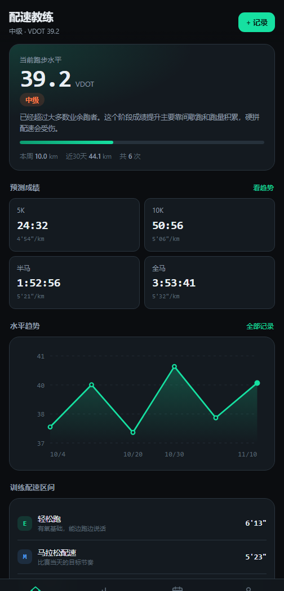

# 配速教练 · PaceLab

手机上的跑步水平评估与训练计划工具。录入跑步数据（手填或传一张跑步 App 截图），
算出你**当前的真实水平**、**预测 5K / 10K / 半马 / 全马成绩**，并生成一份**逐日可打卡**的训练计划。

纯静态页面，无后端、无账号、无数据上传。所有数据只存在你自己的设备上。



---

## 它到底算什么

| 能力 | 依据 |
|---|---|
| 水平分级 | Jack Daniels **VDOT** 模型（VO2max 与可持续时间的关系） |
| 成绩预测 | 由 VDOT 反解任意距离的比赛成绩（二分法求解，误差 <1 秒） |
| 训练配速 | E / M / T / I / R 五档，取自 VDOT 体系的 `%VO2max` 区间 |
| 训练计划 | 按你的**实际周跑量**排周期，周增幅硬封顶 10% |

**为什么不用线性外推：** 拿 5K 成绩按配速直接放大到全马，误差能到 20 分钟以上，
因为人体在不同距离下能维持的 `%VO2max` 根本不同。VDOT 模型处理的就是这件事。

实测校验：5K 20:00 → VDOT 49.8 → 预测 10K 41:28 / 半马 1:31:50 / 全马 3:11:17，
与 Daniels 官方表格逐项吻合，详见 `tests/algorithm.test.mjs`。

---

## 功能

- **数据录入** — 距离 + 时/分/秒三格（不用全填，空的按 0 算），或上传跑步截图自动识别
- **本地 OCR** — Tesseract.js 引擎和语言包都在本机，识别过程图片不出设备；识别前先做放大 + 灰度 + 对比度拉伸，同一张图跑两遍不同版面分割模式再合并候选，小数点被读丢也能救回来
- **识别不硬填** — 距离、用时、配速三者互相印证才自动填入；对不上就明说，不拿日期时间凑数
- **水平评估** — VDOT 分级 + 趋势曲线；近 90 天加权，越近的、越接近目标距离的记录权重越高
- **成绩预测** — 四个距离的成绩与对应配速
- **训练配速** — 五档区间，直接照着跑
- **训练计划** — 5K/10K/半马/全马，3–5 练/周，逐日列出课表、距离、配速、要点
- **打卡闭环** — 每天一个「完成」按钮，点完邀请你补数据；数据进来后重算水平，形成闭环
- **可视化** — 水平趋势、配速趋势、近 8 周跑量，全部手写 SVG，零依赖
- **数据自主** — 一键导出 JSON 备份，换手机靠文件迁移

---

## 部署到 GitHub Pages（3 分钟）

本地目录叫「跑步app」，仓库已经初始化并完成首次提交，只剩关联远程这一步：

```bash
# 1. 在 GitHub 新建一个空仓库，名字建议 pacelab（别用中文名，URL 会变成转义串）

# 2. 关联并推送（把 <你的用户名> 换掉）
git remote add origin https://github.com/<你的用户名>/pacelab.git
git push -u origin main
```

推之前先确认作者邮箱是对的 —— 仓库初始提交用的是占位邮箱，改掉再推，否则提交记录里的作者信息是错的：

```bash
git config user.email "你的邮箱@example.com"
git commit --amend --reset-author --no-edit
```

然后到仓库 **Settings → Pages**：

- Source 选 `Deploy from a branch`
- Branch 选 `main`，目录选 `/ (root)`
- 保存，等 1 分钟

访问 `https://<你的用户名>.github.io/pacelab/` 即可。

所有资源都用相对路径引用，**放在子路径下也能正常工作**，不用改任何配置。

### 装到手机主屏（变成 App）

- **iPhone**：Safari 打开 → 分享按钮 → 「添加到主屏幕」
- **Android**：Chrome 打开 → 右上角菜单 → 「安装应用」/「添加到主屏幕」

装完之后是**独立图标、全屏运行、没有地址栏**，跟原生 App 的操作感一致，且断网可用。

### 打成真正的安卓 APK

仓库里带了完整的安卓壳工程（`android/`）：原生 WebView + 本地资源，不依赖任何在线服务，
断网也能跑。**图片识别引擎（约 11MB）已经打进安装包里**，装完就能用，不需要联网下载。

```bash
# 一次性准备：JDK 17 + Android SDK（platform-34 / build-tools 34.0.0）

node android/sync-web.mjs          # 把网页资源同步进 assets（每次改网页后都要跑）
cd android
./gradlew assembleRelease          # 产物：app/build/outputs/apk/release/app-release.apk
```

装到手机：把 apk 传到手机 → 点击安装 → 允许「未知来源」即可。

完整步骤、环境变量、常见报错见 **[docs/安卓打包.md](docs/安卓打包.md)**。

**动手改代码之前先读 [docs/开发记录.md](docs/开发记录.md)** —— 里面记着每个技术选型否掉了什么、
以及踩过的坑（事件传播、`display:none` 的 file input、千分位当小数、日期当用时……）。
很多坑踩第二次的代价比读一次文档高得多。

> 没配签名密钥也能构建：会自动退回 debug 签名，照样能装能跑。
> 要自己发版，按文档生成一个 keystore 放进 `android/keystore.properties` 即可。

---

## 目录结构

```
跑步app/
├── index.html              入口
├── manifest.webmanifest    PWA 配置（图标、全屏、主题色）
├── sw.js                   离线缓存（改业务代码记得升 VERSION）
├── css/app.css             全部视觉参数集中在 :root
├── js/
│   ├── core.js             VDOT 算法、成绩预测、配速区间（纯函数）
│   ├── plan.js             训练计划生成器（纯函数）
│   ├── store.js            本机存储 + 导出导入 + 图片压缩
│   ├── chart.js            SVG 折线图 / 柱状图（零依赖）
│   ├── ocr.js              截图识别（本地引擎优先，CDN 兜底）
│   └── app.js              UI 渲染与交互
├── vendor/                 OCR 引擎与语言包（离线用，约 11MB）
├── android/                安卓壳工程（WebView + 本地资源）
│   ├── app/src/main/java/com/pacelab/coach/MainActivity.java
│   └── sync-web.mjs        网页资源 → assets 同步脚本
├── tests/
│   ├── algorithm.test.mjs  VDOT 与计划生成
│   ├── ocr-parse.test.mjs  识别文本解析
│   ├── form-save.test.mjs  表单录入链路 + 事件传播护栏
│   └── syntax-compat.test.mjs  旧 WebView 语法兼容
├── tools/
│   ├── verify-ocr.mjs      端到端识别验证（起无头浏览器真跑）
│   ├── verify-upload.mjs   端到端上传链路验证
│   └── fixtures/           验证用截图（英文结果页 / 中文深色主题）
├── docs/
│   ├── 安卓打包.md           打包与安装说明
│   └── 开发记录.md           决策与踩坑记录（改代码前先看）
└── assets/                 图标与截图
```

网页部分零构建步骤、零 npm 依赖、零框架，改完直接 push 就能生效。

---

## 换皮肤

所有颜色、圆角、间距、字体都集中在 `css/app.css` 顶部的 `:root`。
换一套视觉只需要改那 20 行变量，组件样式不用动：

```css
:root {
  --primary: #16e0a1;   /* 主色：按钮、强调、曲线 */
  --bg: #0b0d10;        /* 页面底色 */
  --surface: #141a20;   /* 卡片底色 */
  --text: #e9eef3;      /* 主文字 */
  --radius: 18px;       /* 卡片圆角 */
  /* ... */
}
```

---

## 跑测试

```bash
node tests/algorithm.test.mjs     # VDOT 与训练计划：13 项
node tests/ocr-parse.test.mjs     # 截图识别解析：21 项
node tests/form-save.test.mjs     # 表单录入链路 + 事件传播护栏：12 项
node tests/syntax-compat.test.mjs # 旧 WebView 语法兼容：5 项
node tools/verify-ocr.mjs         # 端到端：真起浏览器，喂三张图跑识别
node tools/verify-upload.mjs      # 端到端：模拟选图 → 识别 → 自动填入 → 保存
FX=user-vivo-card.jpg node tools/verify-upload.mjs   # 同一条链路，换成真机失败样本
```

`algorithm` 覆盖 VDOT 反算精度、往返一致性、配速区间顺序、计划结构完整性、
跑量增幅红线、赛前减量、脏数据拦截。

`ocr-parse` 的输入全部是**真实 OCR 输出**（不是手写的理想数据），覆盖单位丢失、
时长被误判成配速、只有时长+配速需反推距离、中文「1小时23分45秒」写法、
OCR 把 0 认成 O、小数点被读成空格（`1.55` → `1 55`）、千分位步数被当成距离
（`1,404` → `1.404`）、右上角日期时间被当成用时（`下午7:38:26`）这些实际会踩的场景。
后三类全部来自一张真机失败的 vivo WATCH 截图，用 `tools/run-variants.mjs` 跑出来的。

`form-save` 走完整的「点新增 → 填三格 → 点保存 → 查存储」链路，还带三条
源码级护栏：全局点击必须绑捕获阶段、弹层不能有内联 `stopPropagation`、
遮罩关闭必须判断点击目标。**这三条是踩过的坑，别改回去。**

`syntax-compat` 卡住可选链、空值合并、正则后行断言这些新语法。minSdk 是 24，
老机器上的 WebView 可能停在 Chrome 60-79，出现这些语法不是功能降级，
是**整个文件解析失败、打开就白屏**，PC 浏览器和新手机上永远测不出来。

`verify-ocr` 是真跑：起静态服务 + 回调服务 + 无头浏览器，喂 `tools/fixtures/`
里的两张图（英文结果页 / 中文深色主题截图），断言距离、时长、配速、置信度。

`verify-upload` 也是真跑：模拟「从相册选了一张截图」，验证点上传区命中的是原生
`<input type="file">`、识别结果自动填入三段用时、保存后数据真的落库。
**用户报的「上传没反应」「保存不了」都在这条链路上，只有真跑浏览器才测得出来。**

**改算法或改识别正则之前先跑一遍，改完再跑一遍。**

---

## 数据与隐私

- 全部数据存在本机（网页版走 `localStorage`，安卓版走 WebView 存储），**不上传任何服务器**
- 截图识别完全在本地完成：网页版优先用 `vendor/` 里的引擎，缺失才联网下载；安卓版引擎已打包，全离线
- 「我的 → 导出备份」可随时导出 JSON；安卓版会存到手机「下载」目录
- 清空浏览器数据 / 卸载 App 会丢失记录，**重要数据请先导出**

---

## 已知边界（别指望它做到的事）

- 预测成绩假设你**全力**跑一次比赛。拿训练跑的配速去预测，结果一定偏低
- 高温高湿环境下实际配速会慢 10–20 秒/公里，模型不知道今天几度
- VDOT 模型对超长距离（超马）和走跑结合的新手不准，数据会失真
- 训练计划是基于通用运动学原理排的，**不替代教练**。有旧伤、心率异常、关节疼痛请就医
- 截图识别只认数字，中文界面文字会识别成乱码 —— 这是设计取舍，数字识别准确率优先

---

## 技术栈

**网页端**：原生 HTML + CSS + ES Modules。没有框架，没有构建，没有 `node_modules`。
图表是手写 SVG，OCR 是 Tesseract.js（唯一外部依赖，引擎文件已放进 `vendor/`）。
这样做的理由很简单：这个 App 的交互复杂度不值得引入一个 40KB 的运行时和一套构建链，
换来的是「改一行代码、push、刷新即可生效」的维护体验。

**安卓端**：一个 280 行的 `MainActivity`，用 `WebViewAssetLoader` 把 `assets/www`
挂到 https 域名下加载。不做混合开发、不引 Capacitor——这个 App 对原生能力的需求
只有三样：文件选择、导出落盘、返回键。为此拉一整套跨端框架，是拿维护成本换不存在的收益。
