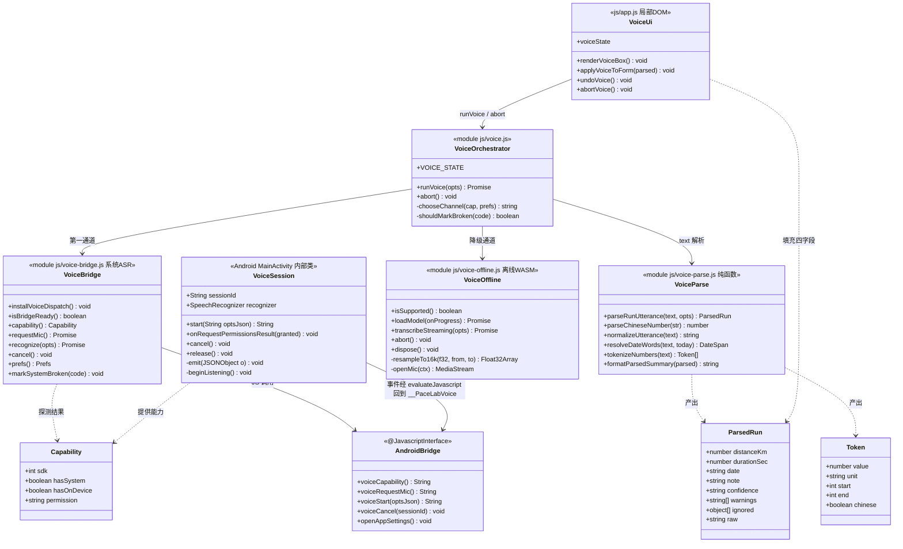
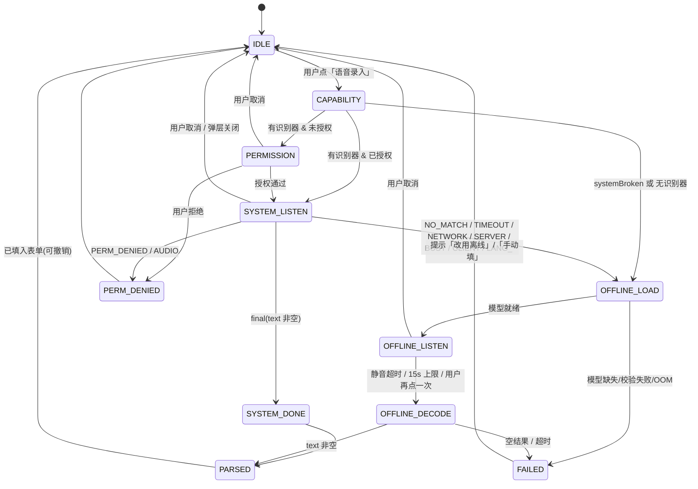
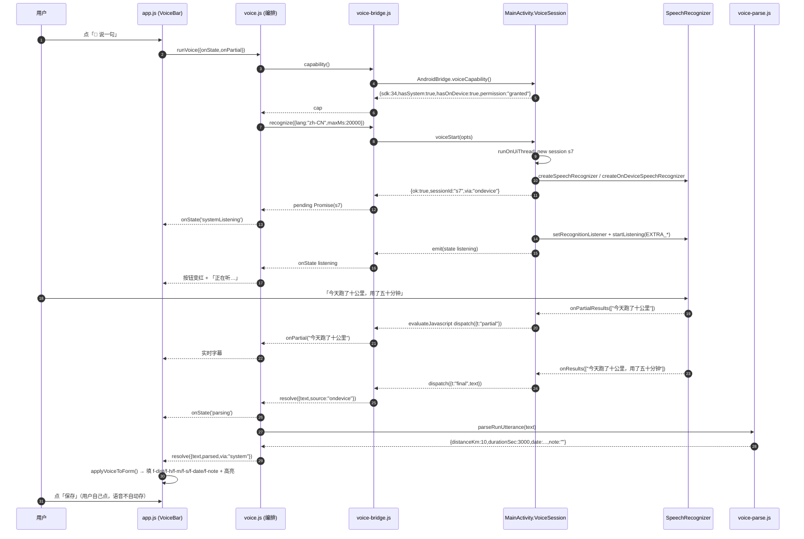

# PaceLab 语音录入 · 系统设计（Architect / v1）

> 目标：在「录入一次跑步」弹层加语音按钮，本地转文本 → 解析出**距离 / 用时 / 日期 / 备注** → 填进表单（不自动保存）。
> 通道优先级：Android 系统 ASR → 失败自动降级到内置离线 WASM 模型。
> 约束：零构建、ES modules、旧 WebView 兼容、不破坏 OCR/计划/历史/导出导入、`android/` 需要改。

---

## 0. 决策一览（先看这张表）

| 议题 | 结论 |
|---|---|
| 系统 ASR 回传机制 | `evaluateJavascript` 回调（Java → JS 单入口 `window.__PaceLabVoice.dispatch(jsonStr)`），JS 侧包成 Promise；**不用轮询** |
| 权限 | Java 内 `requestPermissions` + `onRequestPermissionsResult` 续跑挂起的会话；权限拒绝**不降级**（两条通道都要麦克风） |
| Android 13+ | 无新增权限；但 **targetSdk≥30 必须加 `<queries>` 声明 `android.speech.RecognitionService`**，否则 `isRecognitionAvailable()` 恒 false |
| 离线模型 | **vosk-browser 0.0.8 + vosk-model-small-cn-0.22（42MB zip）**；排除 whisper.cpp（内存/线程）与 sherpa-onnx（胶水层成本） |
| 音频采集 | `getUserMedia` + **ScriptProcessorNode**（不是 AudioWorklet），`AudioContext` 优先 16k，拿不到就 JS 重采样 |
| WebView 采音前置条件 | 必须实现 `WebChromeClient.onPermissionRequest` 并 `grant()`，否则 `getUserMedia` 直接 `NotAllowedError` |
| 降级判定 | 系统侧 `NOT_AVAILABLE / CLIENT / LANG_*` → 记「本机坏了」永久跳过；`NO_MATCH / TIMEOUT / NETWORK` → 只本次降级 |
| 解析 | 纯函数 `parseRunUtterance(text)`，五段流水线；无单位口语**不做激进猜测**（低置信 + 提示核对） |
| 填充策略 | 直接填 + 粉框高亮 0.8s + 「撤销」；只覆盖语音提到的字段，未提到的保持原值 |
| 弹层重绘 | 语音过程中**绝不调用 `render()`**（会清空用户已输入内容），只做局部 DOM 更新 |
| Web 版 | 不显示语音按钮（无系统 ASR，且模型不入库）→ feature-detect `AndroidBridge.voiceStart` |
| APK 体积 | 15MB → **约 62MB**（42MB 模型 + 5.8MB 引擎），比产品说的 57MB 多约 5MB，见 §10 风险 R1 |

---

## 1. 实现方案与选型

### 1.1 核心难点

1. `@JavascriptInterface` **只有同步返回值，没有回调**——而 `SpeechRecognizer` 天生异步。
2. 运行时权限（Android 6+）与语音链路是两条异步流，必须串起来且不能泄漏会话。
3. 中文口语解析（数字/单位/日期/备注）是本功能真正的事故源，比 ASR 本身更容易错。
4. 旧 WebView：`AudioWorklet`(Chrome 66+)、`AudioContext({sampleRate})`(Chrome 74+) 都不可靠，而 minSdk 24 的设备 WebView 可能停在 Chrome 60 左右。
5. 项目是「整页 innerHTML 重绘 + 事件委托」，任何在语音过程中触发的 `render()` 都会清空用户刚填的距离/用时。

### 1.2 系统 ASR（第一通道）

- 用 `SpeechRecognizer`（不是 `ACTION_RECOGNIZE_SPEECH` Intent）：Intent 会跳出去换一个全屏界面，回不到我们的弹层。
- 设备能力三级：
  1. `Build.VERSION.SDK_INT >= 31 && SpeechRecognizer.isOnDeviceRecognitionAvailable(ctx)` → `createOnDeviceSpeechRecognizer()`：**纯离线、无第三方 UI 覆盖层**，体验最一致，优先。
  2. 否则 `SpeechRecognizer.isRecognitionAvailable(ctx)` → `createSpeechRecognizer()`：可能弹厂商自己的识别浮层（MIUI/EMUI 常见），可接受。
  3. 都不行 → 立刻回 `NOT_AVAILABLE`，**此时还不申请麦克风权限**（别让用户先授权再被拒）。
- 识别参数：`EXTRA_LANGUAGE="zh-CN"`、`EXTRA_LANGUAGE_MODEL=LANGUAGE_MODEL_FREE_FORM`、`EXTRA_PARTIAL_RESULTS=true`、`EXTRA_MAX_RESULTS=1`、`EXTRA_CALLING_PACKAGE=getPackageName()`、`EXTRA_PREFER_OFFLINE=true`（仅 on-device 实例）。静音自动收尾：`EXTRA_SPEECH_INPUT_COMPLETE_SILENCE_LENGTH_MILLIS=1200`、`POSSIBLY_COMPLETE=1200`、`MINIMUM_LENGTH=1000`（国产识别器多数忽略，仅作提示）。
- **必须**把 `SpeechRecognizer` 存在 Activity 字段里：局部变量会被 GC 回收，表现为「识别到一半突然没了」，是本功能最经典的坑。
- 所有 `SpeechRecognizer` 调用（create/startListening/stopListening/destroy）**必须在主线程**。

### 1.3 离线模型选型对比

| 方案 | 体积 | 中文效果 | WebView 可行性 | 结论 |
|---|---|---|---|---|
| **vosk-browser 0.0.8 + small-cn-0.22** | 引擎 5.8MB（wasm 已内联，单文件）+ 模型 42MB | 小模型 CER 一般，但我们的词汇是数字/单位/今天昨天，命中率高 | 只要 `getUserMedia` + ScriptProcessor；wasm 内联进 js，**无 wasm MIME 坑**；模型是单文件压缩包，assets 里就一个文件 | ✅ **选它** |
| whisper.cpp WASM（tiny q5_1 ≈ 32MB） | 32–75MB | tiny 中文差 | 需要 `SharedArrayBuffer` → 要 COOP/COEP 响应头 → 得改 `WebViewAssetLoader` 全局拦截，影响 Tesseract worker；单线程 wasm 下 5s 音频要十几秒 | ❌ 排除 |
| sherpa-onnx WASM（流式 zipformer zh 14M int8） | 引擎+模型 ~25MB | 更好 | 需自己写 C++ wasm 胶水层（`sherpa-onnx-wasm-main-asr.js` + `.data`），零构建项目里维护成本高 | ❌ 排除（体积更优，但不是本次该付的成本） |
| Web Speech API（`webkitSpeechRecognition`） | 0 | — | **Android WebView 根本没实现**，只有 Chrome 浏览器有 | ❌ 直接排除 |
| 只用系统 ASR、不内置离线 | 0 | — | 装不上 Google App 的国产 ROM / 精简 ROM 上功能完全不可用 | ❌ 产品已否决 |
| 纯关键词/语法识别（只识别数字+单位） | ~5MB | 数字很准 | 备注是自由文本，语法受限模型做不到 | ❌ 排除 |

**为什么是 vosk-browser**：
- 模型是**单个归档文件**（`model.zip`），assets 里只多一个文件，绕开「几千个小文件 + 大小写敏感 + aapt 压缩策略」全部麻烦。
- 5.8MB 的 `vosk.js` 把 wasm 内联了，不依赖 `application/wasm` MIME（Android 老系统的 `MimeTypeMap` 对 `wasm` 返回 null，`instantiateStreaming` 会失败——本项目正好不用趟这个坑）。
- 文档化的 `acceptWaveform(AudioBuffer)` 与 `ScriptProcessorNode` 是天作之合，不需要 AudioWorklet。

**模型获取**：
- 官方地址 `https://alphacephei.com/vosk/models/vosk-model-small-cn-0.22.zip`（42MB）。
- 放 `vendor/vosk/model.zip`，引擎放 `vendor/vosk/vosk.js`（从 npm 包 `vosk-browser@0.0.8` 的 `dist/vosk.js` 拷出来）。
- 归档内顶层目录官方叫 `vosk-model-small-cn-0.22/`；vosk-browser 期望单顶层目录并被剥掉。为消除不确定性，`tools/fetch-vosk.js` 下载后**用 node 重新打包成顶层目录名 `model/`**，输出 `vendor/vosk/model.zip`（同时打印 sha256）。
- **42MB 不入 git**：`vendor/vosk/model.zip` 加进 `.gitignore`，用 `node tools/fetch-vosk.js` 拉取；`android/sync-web.mjs` 缺模型时**硬失败**（防「悄悄少打包一个功能」）。

### 1.4 音频采集（离线通道）

```
getUserMedia({audio:{channelCount:1, echoCancellation:true, noiseSuppression:true, autoGainControl:true, sampleRate:16000}})
  → AudioContext（try new AudioContext({sampleRate:16000})；失败退 new AudioContext()）
  → createMediaStreamSource(stream)
  → createScriptProcessor(4096, 1, 1)     // 4096 @48k ≈ 85ms/块，延迟与开销平衡
  → 连接到 zero-gain GainNode → destination（不连 destination 某些内核不跑 onaudioprocess）
```

- **不用 AudioWorklet**：`addModule` 是 Chrome 66+，minSdk 24 的机器可能更旧；且要多一个文件 + 一次跨 origin 的模块加载，收益（性能）在我们这种 5 秒短句上体现不出来。`ScriptProcessorNode` 虽然被标 deprecated，但 Chrome 130 仍在，全版本可用。
- `ctx.sampleRate !== 16000` 时用 `resampleTo16k()`（装箱线性插值，带小数索引 carry），再用 `ctx.createBuffer(1, n, 16000)` 造 16k AudioBuffer 交给 `recognizer.acceptWaveform()`。
- WebView 侧两个**必须**的配套：
  - `WebChromeClient.onPermissionRequest` → 只对 `APP_ORIGIN` 且 `RESOURCE_AUDIO_CAPTURE` 调 `request.grant()`，其他 `deny()`。不实现它，`getUserMedia` 永远 `NotAllowedError`。
  - `AudioContext` 可能在 `suspended` 状态，用户点击后调 `ctx.resume()`（`setMediaPlaybackRequiresUserGesture(false)` 已配，但 resume 仍要显式做）。
- 停止条件：说话 ≥800ms 后连续 1200ms RMS 低于阈值 → 自动收尾；硬上限 15s；也可用户再点一次按钮立即收尾。
- 收尾：喂 0.6s 静音把 Vosk 的 endpoint 冲出来，等最后一个 `result`；1.5s 内没等到就用最后一次 `partialresult` 兜底。

### 1.5 性能/资源预期（估值，需 T03 spike 实测）

| 指标 | 预期 |
|---|---|
| 首次加载模型（assets 读 42MB + 解压 + wasm init） | 3–8s（中端机 5s 左右），**必须有进度提示**，否则用户以为卡死 |
| 二次识别 | 0（模型常驻模块级变量） |
| 常驻内存 | 模型解码后约 60–90MB + wasm 堆，**中低端 2GB 机型有 OOM 风险**（R4） |
| 5 秒语音的离线耗时 | 流式识别，边说话边算，约 1–2 倍实时；说完到出结果 **0.5–2s**；不是「说完再等 10 秒」 |
| 系统 ASR 延迟 | 说停到 `onResults` 约 0.3–1s |

> 离线只在系统 ASR 失败时才走，绝大多数用户不会感知到模型加载。

---

## 2. 文件清单

### 新增

| 文件 | 职责 | 关键导出/签名 |
|---|---|---|
| `js/voice-parse.js` | **纯函数**，无 DOM 无网络。文本 → 结构化字段。唯一被 node 单测覆盖的模块 | `parseRunUtterance(text, opts) -> ParsedRun`<br>`parseChineseNumber(str) -> number\|null`<br>`normalizeUtterance(text) -> string`<br>`resolveDateWords(text, today) -> {date, spans}`<br>`formatParsedSummary(parsed) -> string` |
| `js/voice-bridge.js` | 系统 ASR 的 JS 侧：安装 `window.__PaceLabVoice`、能力探测、Promise 包装、会话 ID 校验、超时、偏好持久化 | `installVoiceDispatch()`<br>`isBridgeReady() -> bool`<br>`capability() -> {sdk, hasSystem, hasOnDevice, permission}`<br>`requestMic() -> Promise<bool>`<br>`recognize(opts) -> Promise<{text, source}>`<br>`cancel()`<br>`prefs / markSystemBroken / clearPrefs` |
| `js/voice-offline.js` | vosk 引擎：注入脚本、加载模型（带进度）、采音、重采样、VAD 收尾、结果聚合 | `isSupported() -> bool`<br>`loadModel(onProgress) -> Promise<Model>`<br>`transcribeStreaming({onPartial, onLevel, maxMs, silenceMs}) -> Promise<{text}>`<br>`abort()` / `dispose()` |
| `js/voice.js` | 编排层：状态机、通道选择、降级与记忆、对外唯一入口 | `runVoice({onState, onPartial, onLevel}) -> Promise<{text, source, via}>`<br>`abort()`<br>`VOICE_STATE` 常量 |
| `tests/voice-parse.test.mjs` | 解析规则单测（node 直跑，与现有测试同风格） | — |
| `tests/fixtures/voice-cases.mjs` | 18 条解析用例的唯一数据源（单测与 `tools/verify-voice.mjs` 共用，避免两处各写一份期望值） | `export const CASES = [{ text, expect, note }]` |
| `tools/fetch-vosk.js` | 下载/校验/重打包模型 → `vendor/vosk/model.zip` | — |
| `tools/voice-probe.html` | 手动 spike 页：只做「加载模型 → 采音 → 显示文本」，用来确认模型格式与体积 | — |
| `tools/verify-voice.mjs` | headless CDP 端到端：注入假 `AndroidBridge`，验证「识别结果 → 表单字段 / 备注 / 撤销 / 失败提示」 | — |
| `vendor/vosk/vosk.js` | 引擎（5.8MB，从 npm 包拷，**入库**） | 全局 `Vosk` |
| `vendor/vosk/model.zip` | 模型（42MB，**不入库**） | — |

### 修改

| 文件 | 改什么 |
|---|---|
| `js/app.js` | import `voice.js`/`voice-parse.js`；`ui.voice` 状态；`modalAddRun()` 里插 `<div id="voice-box">` 与按钮；`handleClick` 加 `voice:*` 分支；`applyVoiceToForm()`/`undoVoice()`；`closeModal()` 里 `abortVoice()`。**不动 `saveRun()` 的 `source` 字段**（有测试 fixture 依赖） |
| `css/app.css` | `.voice-bar` / `.voice-btn` / `.voice-btn.rec`（录音脉冲）/ `.voice-partial`（气泡）/ `.voice-tags`（识别结果 chip）/ `.just-filled`（粉框高亮）/ `.voice-note` |
| `android/app/src/main/java/com/pacelab/coach/MainActivity.java` | 新增 `VoiceSession` 内部类 + `Bridge` 的 4 个新方法 + `onRequestPermissionsResult` + `WebChromeClient.onPermissionRequest` + `onPause/onDestroy` 清理 |
| `android/app/src/main/AndroidManifest.xml` | `<uses-permission android:name="android.permission.RECORD_AUDIO" />` + `<queries><intent><action android:name="android.speech.RecognitionService"/></intent></queries>` |
| `android/app/build.gradle` | `versionCode 20` / `versionName '1.12.0'`；`noCompress += ['zip']`（避免对 42MB zip 二次压缩，构建更慢、收益为负） |
| `android/sync-web.mjs` | 拷贝前检查 `vendor/vosk/model.zip` 存在，缺失则 `process.exit(1)` 并提示跑 `node tools/fetch-vosk.js`；打印 vendor 体积 |
| `.gitignore` | 追加 `vendor/vosk/model.zip` |
| `.gitattributes` | 追加 `*.vosk binary`（若将来改名） |
| `sw.js` | `VERSION` 升位 + `CORE` 里补 `./js/voice-parse.js`、`./js/voice.js`、`./js/voice-bridge.js`（**不要**把 42MB 模型放进预缓存） |
| `README.md` | 功能列表 + 「构建前先 `node tools/fetch-vosk.js`」 |

> ⚠️ **所有新 JS 必须放 `js/` 扁平目录**：`tests/syntax-compat.test.mjs` 只扫 `fs.readdirSync(JS_DIR)` 第一层，放子目录等于绕过 `?.`/`??` 护栏。

### 2.1 模块关系（类图，另存 `docs/voice-class.mermaid`）



---

## 3. Bridge 协议（JS ↔ Java）

### 3.1 JS → Java（`@JavascriptInterface`，同步返回）

```java
String  voiceCapability()            // JSON
String  voiceRequestMic()            // JSON {state:"granted"|"prompt"}
String  voiceStart(String optsJson)  // JSON {ok:true,sessionId,via:"ondevice"|"system"} | {ok:false,code,message}
void    voiceCancel(String sessionId)
void    openAppSettings()
```

- 这些方法跑在 WebView 的 **JavaBridge 线程**（不是主线程）→ `voiceStart` 内部 `runOnUiThread` 起识别并**立即返回** sessionId；`voiceCapability` 只做 `checkSelfPermission` / `isRecognitionAvailable` / `isOnDeviceRecognitionAvailable`，都可在非主线程调用。
- `voiceStart` 的 `optsJson`：`{"lang":"zh-CN","partial":true,"maxMs":20000}`。

### 3.2 Java → JS（单入口）

```java
private void emit(JSONObject o) {
    final String js = "window.__PaceLabVoice&&window.__PaceLabVoice.dispatch("
                    + JSONObject.quote(o.toString()) + ")";
    runOnUiThread(new Runnable() { public void run() {
        if (web != null) web.evaluateJavascript(js, null);
    }});
}
```

`JSONObject.quote()` 输出带转义的合法 JS 字符串字面量（含中文、引号、换行），不要自己拼引号。

### 3.3 事件表（全部带 `sessionId`，`permission` 除外）

| 事件 | 字段 | 说明 |
|---|---|---|
| `state` | `s: permission｜listening｜processing｜idle` | 只做 UI 提示 |
| `partial` | `text` | 实时字幕。**`text` 可能为空串**（Android 13 常发空 partial），JS 收到空串时**保留上一次显示**，不要清空 |
| `final` | `text, source:"system"｜"ondevice", ms` | 终态，Promise resolve |
| `error` | `code, message, fatal, permanent?` | `fatal=true` 才封装成 reject |
| `permission` | `granted, permanent` | `voiceRequestMic` / 系统识别前的授权结果 |

### 3.4 错误码（Java 侧映射 Android 常量 → 我们的字符串）

| Android `onError` | 我们的 code | 是否降级 | 是否记永久坏 |
|---|---|---|---|
| `ERROR_NETWORK`(2) / `ERROR_SERVER_DISCONNECTED`(11) | `NETWORK` | 是 | 否 |
| `ERROR_NETWORK_TIMEOUT`(1) / `ERROR_SPEECH_TIMEOUT`(6) | `TIMEOUT` | 是 | 否 |
| `ERROR_AUDIO`(3) | `AUDIO` | 否（麦克风被占用，离线也拿不到） | 否 |
| `ERROR_SERVER`(4) | `SERVER` | 是 | 否 |
| `ERROR_CLIENT`(5) | `CLIENT` | 是 | 是 |
| `ERROR_NO_MATCH`(7) | `NO_MATCH` | 是（一次） | 连续 2 次才记 |
| `ERROR_RECOGNIZER_BUSY`(8) / `ERROR_TOO_MANY_REQUESTS`(10) | `BUSY` | 是 | 否 |
| `ERROR_INSUFFICIENT_PERMISSIONS`(9) | `PERM_DENIED` | **否** | 否 |
| `ERROR_LANGUAGE_NOT_SUPPORTED`(12) / `_UNAVAILABLE`(13) | `LANG_UNSUPPORTED` | 是 | 是 |
| 本地判定（无识别器） | `NOT_AVAILABLE` | 是 | 是 |
| JS 侧超时 | `JS_TIMEOUT` | 是 | 否 |

### 3.5 权限流程时序（关键：两条异步流怎么串）

```
JS: capability() → {permission:'prompt', hasSystem:true}
JS: voiceStart(opts)
  [JavaBridge 线程] 校验 origin → 分配 sessionId=s7 → runOnUiThread(start)
  [主线程] 已有会话? → 回 BUSY
           无识别器? → emit(error NOT_AVAILABLE) → 直接返回（不申请权限）
           已授权?   → beginListening() → emit(state listening)
           未授权?   → pendingSession=s7 → emit(state permission) → requestPermissions(REQ_AUDIO=1002)
  [返回] {ok:true, sessionId:"s7"}
JS: 进入「等待授权」态（Promise 继续挂着，不超时）
  [用户点允许] onRequestPermissionsResult(1002, GRANTED) → beginListening() → emit(state listening)
  [用户点拒绝] → emit(error PERM_DENIED, permanent = !shouldShowRequestPermissionRationale())
                 JS: 弹「去设置开权限」，不再尝试离线通道（离线也要麦克风）
```

- `voiceCancel` 必须能打断上面任意一步：清 `pendingSession`、`stopListening`、`destroy`、`emit(state idle)`。
- Activity `onPause` 也走同一套清理（识别器在后台必死，不清理就是泄漏）。
- **权限拒绝不是降级理由**：两条通道都依赖 `RECORD_AUDIO`。产品上把它当成「配置问题」，给「去设置」入口（`openAppSettings()`）。

---

## 4. 状态机



`PERM_DENIED` 与 `FAILED` 的区别要落到文案上：
- `PERM_DENIED` → 「没麦克风权限，点这里去设置」
- `FAILED` → 「没听清，再说一次 / 手动填」

**记忆规则**（`localStorage['pacelab.voice.v1']`）：

| 键 | 何时写 | 何时清 |
|---|---|---|
| `systemBroken:true` | `NOT_AVAILABLE`、`CLIENT`、`LANG_UNSUPPORTED`、`NO_MATCH` 连续 2 次 | 30 天后重试一次；或用户点「重试系统识别」；`VOICE_PROTO_VERSION` 变更 |
| `lastOk:'system'｜'offline'` | 成功一次 | — |
| `noMatchStreak:n` | `NO_MATCH` | 成功一次 |

**「每次都先试系统会不会被感知成慢」**：不会。系统识别器 `startListening` 到出「请说话」提示约 200–500ms，用户本来就要张嘴说话，这段被完全掩盖。反过来说，一旦 `systemBroken` 就别每次都试——国产 ROM 上失败的 `bindService` 会卡 1–2 秒。

---

## 5. 中文口语解析规则（本功能最容易出错的部分）

### 5.1 流水线（顺序不可换）

```
rawText
 → ① 归一化 normalizeUtterance
 → ② 日期抽取（必须早于数字抽取，否则「十一月二十五号」会被当成两个数字）
 → ③ 排除指标预剥（配速/心率/步频/步幅/卡路里）
 → ④ 数字+单位 tokenize 与配对
 → ⑤ 槽位仲裁（距离/用时/裸数字）
 → ⑥ 合理性校验 + 交叉校验（配速）
 → ⑦ 备注抽取（用 consumed 位图）
 → ParsedRun
```

**为什么 ② 必须在 ④ 之前**：`十一月二十五号` 里 `十一`/`二十五` 都是合法数字，先抽数字就必然把日期吃掉。

### 5.2 ① 归一化

| 规则 | 例 |
|---|---|
| 全角数字/标点 → 半角（`０-９`、`．，。：`） | `１０．５` → `10.5` |
| **删除所有空白字符**（Vosk 中文模型会输出「今 天 跑 了 十 公 里」，逐字空格是最常见的坑） | `今 天 跑 了` → `今天跑了` |
| 常见繁体 → 简体（约 20 字表：`公裏/分鐘/小時/個/兩/號/鐘頭/麼/幾/裏`…） | `公裏` → `公里` |
| 保留标点（`,。;！？`），只用于「首小句」判定，不进数字扫描 | — |

### 5.3 中文数字 `parseChineseNumber`

| 输入 | 输出 | 规则 |
|---|---|---|
| 一/幺 | 1 | 单字表 |
| 二/两/俩 | 2 | 量词前「两」 |
| 十 | 10 | 裸「十」 |
| 十五 | 15 | `十` + 个位 |
| 二十 / 二十五 | 20 / 25 | 十位 + 可选个位 |
| 一百 / 一百零五 / 两百五 | 100 / 105 / 250 | 「百」后裸数字 = ×10（口语省略） |
| 一千五 | 1500 | 「千」后裸数字 = ×100 |
| 一万 / 两万五 | 10000 / 25000 | 「万」同理 |
| 一零五 / 幺零五 | 105 | 连读数字串（不含 十百千万） |
| 十点五 / 10.5 | 10.5 | 「点」= 小数点，**仅当后面紧跟数字或单位** |
| 半（单独） | 0.5 | 只在与单位组合时生效，见 5.4 |

### 5.4 单位表（最长匹配优先）

| 单位词 | 归一 | 备注 |
|---|---|---|
| 公里 / 千米 / 公里数 | 距离 ×1 | |
| `km` / `kms` / 数字后紧跟 `k`/`K`（`10k`） | 距离 ×1 | |
| 里 | 距离 ×0.5 | 低置信；`公里` 已先匹配 |
| 米 / 公尺 | 距离 ×0.001 | `一万米` → 10km |
| 小时 / 钟头 / `h` / `hr` | 时间 3600 | |
| 分钟 / 分 / `min` / `mins` | 时间 60 | |
| 秒 / 秒钟 / `s` / `sec` | 时间 1 | |
| **拉丁 `m`** | 时间 ×60（**不是**米） | 跑步语境下 `30m` 只会是 30 分钟；米只认中文「米/公尺」 |

**「半」的三种用法**：

| 说法 | 解析 |
|---|---|
| 半小时 | 0.5 × 3600 = 1800s |
| 一个半小时 | `个半` 标记 → 1.5 × 3600 = 5400s |
| 十公里半 / 五公里半 | 数字 + 单位 + 句末「半」→ 10.5km / 5.5km |
| 两个半小时 | 2.5h = 9000s |

### 5.5 时间表达式组合

相邻（间隔 ≤2 字且只含 `零/又/加`）的时间 token 由大到小**相加**：

| 说法 | 结果 |
|---|---|
| `1小时零5分` / `1小时5分` | 3600 + 300 = 3900s |
| `50分30秒` | 3030s |
| `1小时` | 3600s |
| `50分钟` | 3000s |
| `1小时零5分30秒` | 3930s |

「零」在这里是**分隔符**不是数值，`一小时零五分` 不能被读成 105 分。

### 5.6 日期表达（只认**第一个**出现的日期词）

| 说法 | 结果 | 备注 |
|---|---|---|
| 今天/今日/今儿 | 今天 | |
| 昨天/昨日/昨儿/昨 | -1 天 | |
| 前天 | -2 天 | 必须比「昨天」先匹配 |
| 大前天 | -3 天 | 必须比「前天」先匹配 |
| 明天/明日 | +1 天 → **钳到今天** + 警告 `FUTURE_DATE` | 表单 `max=today` |
| `N月N日` / `N月N号` / `N月N` | 今年该日；若 > 今天 → 退到去年 | `十一月二十五号` → 11-25 |
| `N-N` / `N/N` | 月-日（要求 1≤月≤12、1≤日≤31） | `11-25` |
| `N.N` | **不认作日期**（和距离小数冲突） | `11.25` 是距离 |
| 星期X / 周X / 礼拜X | 最近一个该星期几（≤今天） | P1，可与 `昨天` 叠加：`昨天周三` 取昨天 |
| 早上/上午/中午/下午/傍晚/晚上 | 忽略（当填充词剥掉，不进备注） | 不是日期 |

**只认第一个**的规则就是为了「昨天 8 公里 48 分钟，**今天**腿有点酸」：第二个「今天」属于备注，不能被当日期吞掉。所以日期抽取必须带**位置信息**（首发位置的 span 才算消费）。

### 5.7 歧义与冲突仲裁（**逐条写进代码**）

| 场景 | 规则 |
|---|---|
| `15分` 是配速还是用时？ | 先看是否在 `配速` 后面 → 是则剥掉，两条都不进；否则算用时 |
| `十公里` vs `十 公里`（空格被删） | 归一化后自然一致 |
| 两个不同距离（`计划10公里实际跑了8公里`） | 取**最后一个**；若有 `实际/总共/一共/完成` 在 3 字内修饰，取被修饰项；警告 `MULTI_DISTANCE` |
| 两个不相邻的时间段（`跑了50分钟…后来又跑了30分钟`） | 取**最后一段**，警告 `MULTI_DURATION` |
| **全程没有任何单位词**（`跑了 10 50`） | 只有恰好 2 个裸数字才猜：第 1 个→距离（0.5–60 之间）、第 2 个→用时（5–400，按分钟）。`confidence='low'` + 警告 `BARE_NUMBERS`，UI 上标「我猜的，请核对」 |
| 3 个裸数字 | 按 `H M S` 解 → 用时；距离留空，`low` |
| ≥4 个裸数字 / 1 个裸数字 | **不猜**，全部留给备注，警告 `NO_DATA` |
| 距离与用时都有 → 交叉校验配速 | `pace = dur / dist`，落在 `[150s, 900s]`（2:30–15:00/km）之外 → 警告 `IMPLAUSIBLE_PACE`（提示「可能是听错了」），但**仍然填**，让用户自己判断 |
| 距离 >200km 或 <0.2km | 警告 `DIST_RANGE`，不填（大概率听错） |
| 用时 >6h 或 <60s | 警告 `DUR_RANGE`，不填 |
| 只说了日期（`昨天跑的`） | 只填日期，其余留空，正常结束（不算失败） |

### 5.8 备注抽取

1. 建一张与归一化文本等长的 `consumed[]` 位图，日期/数字/单位/被排除指标占用过的位置全部标记。
2. 剩下的字符按顺序拼接；标点 → 空格。
3. 剥填充词（**只在剩余 ≥3 字时才剥**，否则原样保留）：`了 的 我 跑 跑了 跑完 跑步 用了 花了 一共 总共 大概 大约 差不多 左右 然后 就 是 有 个 一次 这次 去 在 感觉`。
4. 丢掉孤立的残留数字/单位（`10`、`分`、`km`）。
5. 折叠空格、去首尾标点；长度 ≤1 → 视为空；截断到 **60 字**（对齐 `#f-note` 的 `maxlength="60"`）。

例：`昨天8公里48分钟今天腿有点酸` → 备注 `今天腿有点酸`（第一个「今天」不存在，只有第二个，未被消费）。

### 5.9 六个必过用例（写进 `tests/voice-parse.test.mjs`）

| # | 输入 | 距离 | 用时 | 日期 | 备注 |
|---|---|---|---|---|---|
| 1 | 今天跑了十公里，用了五十分钟 | 10 | 3000 | 今天 | `` |
| 2 | 跑了 10.5 公里 1 小时零 5 分 | 10.5 | 3900 | 今天 | `` |
| 3 | 昨天 8 公里 48 分钟，今天腿有点酸 | 8 | 2880 | 昨天 | 今天腿有点酸 |
| 4 | 今天跑了10公里50分钟 | 10 | 3000 | 今天 | `` |
| 5 | 前天跑了个五公里，大概半小时 | 5 | 1800 | 前天 | `` |
| 6 | 十一月二十五号，十公里，一小时 | 10 | 3600 | 11-25(今年/去年) | `` |

另有 12 条边界用例：`昨天十公里半`(10.5)、`跑了两个半小时`(9000)、`一万米`(10)、`跑了10k`(10)、`11-25 十公里`、`跑了5公里配速6分`(用时为空 + `PACE_IGNORED`)、`今天跑了 10 50`(low)、`今天状态不错`(全空 + NO_DATA)、`明天十公里`(钳到今天)、`一小时零五分钟`(3900)、`跑了150分钟`(9000)、`跑了30m`(1800，拉丁 m=分钟)。

---

## 6. 时序图（系统 ASR 成功路径）



**JS 侧等待方式**：`recognize()` 返回 Promise；内部
- `final` → `resolve`
- `error{fatal:true}` → `reject({code})`
- 硬超时 `maxMs + 10000` → `reject({code:'JS_TIMEOUT'})`
- `sessionId` 不匹配的事件 → **丢弃**（防上一次会话的迟到回调污染这一次）
- 用户在等待中关弹层 → `V.abort()` → `B.cancel()` + `J.voiceCancel()` + `reject({code:'ABORTED'})`

离线路径同构，把 `B.recognize` 换成 `voiceOffline.transcribeStreaming`，中间多一步 `loadModel(onProgress)`（首次 3–8s，UI 要显示百分比进度条）。

---

## 7. 与现有表单的集成

### 7.1 位置与文案

插在「上传跑步截图」卡片和距离/日期之间（两者都是「把口述/截图变成数字」的同一类操作，放一起用户一眼就懂）：

```html
<div class="voice-bar" id="voice-box">
  <button class="voice-btn" data-act="voice:start">🎤 说一句</button>
  <div class="voice-hint">比如「今天跑了十公里，用了五十分钟」</div>
</div>
```

### 7.2 四个视觉态（只改 `#voice-box` 的 innerHTML，不重绘整页）

| 态 | 表现 |
|---|---|
| idle | 按钮「🎤 说一句」 + 示例文案 |
| listening | 按钮变红 + 呼吸脉冲 + 「正在听…说完停一下」；有 partial 就显示为上浮字幕气泡 |
| working | 按钮禁用 + 转圈 + 「正在识别…」（离线首载时变「准备离线模型 62%」） |
| result | 三个 chip：`距离 10 km` `用时 50:00` `日期 今天`；后面跟 `撤销`；低置信时 chip 前缀 `≈` 并显示「我不太确定，请核对」 |

失败态：红色 chip 一行文字 + 两个按钮「再说一次」「手动填」（关闭语音区）。

### 7.3 填充策略

```
只覆盖语音明确给出的字段；语音没说的字段保持用户原值（不清空）。
覆盖前把旧值存进 ui.voice.undo，用户点「撤销」一次性还原四个字段。
```

理由：语音是用户的**显式动作**，不覆盖会显得没生效；但每次覆盖都留一次后悔药，比「先给预览再确认」少一次点击。

- 距离：`f-dist.value = String(km)`。
- 用时：调**现有** `fillDurationFields(sec)`，与 OCR 完全一致的进位规则；填完调 `refreshDurationHint()` 重算配速提示。
- 日期：`f-date.value = toDateStr(dateObj)`，并 `Math.min(今天)` 钳位。
- 备注：`f-note.value = note.slice(0,60)`。
- 高亮：给被改动的 input 加 `class="just-filled"`，800ms 后移除（`setTimeout`，不需要动画帧）。

### 7.4 部分识别

- 只听到距离 → 填距离，chip 只显示距离，副文案「用时没听到，手动补一下」。
- 什么都没听到（`NO_DATA`）→ **不改任何字段**，把整句原文塞进备注并提示「没听出数字，原话放备注了」。
- 原文一律放一个 `<details>` 折叠区（和 OCR 的 `.ocr-fold` 同款），方便用户/我们排查 ASR 问题。

### 7.5 与 `render()` 的关系（硬约束）

- 语音全过程**禁止** `render()`。`modalAddRun` 的输入框是 DOM 现值的唯一来源，重绘会按 `pre`（打开弹层时的 preset）重建，用户手打的内容直接消失。
- 语音区更新全部走 `renderVoiceBox()`（直接改 `#voice-box.innerHTML`）+ 直接设 `input.value`，与 `handleFileChange` 里 `box.innerHTML = ...` 的风格一致。
- `closeModal()` 里必须 `abortVoice()`：否则识别回调回来时找不到 DOM，还会在下一个弹层里乱填。
- 遮罩点击已有 `e.target === el` 保护，语音按钮不会误关弹层。

### 7.6 不改的东西

- `saveRun()` 的 `source` 字段保持 `'image' | 'manual'` 语义不变（导出格式与 `tests/qa-v11-independent.test.mjs` 的 fixture 依赖它）。语音录入 = `manual`。
- 不新增必填校验、不改 `readDurationSec`、不改 `validateActualEdit`。

---

## 8. 打包与同步

```bash
node tools/fetch-vosk.js        # 首次：下载 42MB → 校验 → 重打包成 model/ 顶层 → vendor/vosk/model.zip
node android/sync-web.mjs       # 缺 model.zip 就 exit 1（不让功能静默缺失）
cd android && ./gradlew assembleRelease
```

- `sync-web.mjs` 的 `COPY` 已含 `vendor`，**无需新增条目**；但因为要拷 42MB，建议加一行体积打印（脚本已有统计逻辑，只是会变成 ~60MB）。
- **assets 大小写**：`vendor/vosk/` 全小写、`model.zip` 全小写，无风险。不要把模型放 `vendor/Vosk/`。
- `build.gradle` 加 `noCompress += ['zip']`：42MB 的 zip 再被 aapt 压一遍只会拖慢构建、几乎不减小（zip 内已压缩）。`.wasm/.traineddata/.gz` 已有，不动。
- 历史教训（`js/ocr.js` 注释）：**aapt2 会把 assets 里的 `.gz` 解压掉并去掉后缀**，所以本方案坚持用 `.zip`（官方原始格式），不自己转 `tar.gz`。这也是排除「tar.gz 单文件」方案的原因。
- `sw.js` 只预缓存 JS/CSS/图标，**不要把 model.zip 放进 `CORE`**（否则网页版首访强拉 42MB）。

---

## 9. 任务分解（5 个任务，按依赖排序）

| ID | 任务 | 源文件 | 依赖 | 优先级 |
|---|---|---|---|---|
| **T01** | **口语解析内核 + 单测**（纯函数，不碰设备，先把最容易出错的部分锁死） | `js/voice-parse.js`（新增）<br>`tests/fixtures/voice-cases.mjs`（新增）<br>`tests/voice-parse.test.mjs`（新增） | 无 | P0 |
| **T02** | **系统 ASR 通道**（Java Bridge + 权限 + JS 包装，含 manifest/gradle） | `android/.../MainActivity.java`（改）<br>`android/app/src/main/AndroidManifest.xml`（改）<br>`android/app/build.gradle`（改）<br>`js/voice-bridge.js`（新增） | 无 | P0 |
| **T03** | **离线 WASM 通道 + 模型准入**（先把 spike 跑通：模型能加载、能出字） | `js/voice-offline.js`（新增）<br>`vendor/vosk/vosk.js`（新增，5.8MB）<br>`tools/fetch-vosk.js`（新增）<br>`tools/voice-probe.html`（新增） | 无 | P1 |
| **T04** | **编排层 + 表单集成 + 样式**（状态机、降级、UI、撤销） | `js/voice.js`（新增）<br>`js/app.js`（改）<br>`css/app.css`（改） | T01, T02, T03 | P0 |
| **T05** | **端到端验证 + 打包收尾**（mock bridge 的 CDP 测试 + 发布链路） | `tools/verify-voice.mjs`（新增）<br>`sw.js`（改）<br>`README.md`（改）<br>`android/sync-web.mjs`（改）<br>`.gitignore` `.gitattributes`（改） | T04 | P1 |

**T01 为什么排第一**：解析错误会污染 VDOT → 训练计划 → 用户三个月的趋势数据。它不依赖任何设备/模型，纯 node 单测就能定死，是整个功能里唯一能做到「一次写对、永不回归」的部分。

**T02 / T03 可并行**：两者只通过 §3 的协议契约耦合。T03 的第一步是 spike（`tools/voice-probe.html` 手动打开，确认 `createModel('model.zip')` 能加载），这个不确定性必须先消掉再写引擎代码。

**每个任务的验收标准**：

- T01：`node tests/voice-parse.test.mjs` 全绿；§5.9 的 18 条用例全覆盖；`node tests/syntax-compat.test.mjs` 通过（新文件在 `js/` 第一层）。
- T02：真机「设置里关掉所有识别器/装 Google App」两种状态下 `voiceCapability()` 返回正确；拒绝权限后点「去设置」能跳系统页；`onPause` 后无泄漏（重复点 10 次不出 `BUSY`）。
- T03：`voice-probe.html` 里 5 秒「今天跑了十公里五十分钟」能出中文文本；断网可跑；记录首载耗时与内存。
- T04：语音填入 4 个字段正确；撤销能还原；语音过程中输入框已打的字不丢；关弹层后无残留回调。
- T05：`node tools/verify-voice.mjs` 通过；APK 体积与功能清单确认。

---

## 10. 风险与待确认

| ID | 风险 | 影响 | 处置 |
|---|---|---|---|
| **R1** | 体积 15MB → **约 62MB**（42 模型 + 5.8 引擎），比产品沟通的 57MB 多 5MB | 用户已接受 57MB，需再确认 | T03 spike 后给出实测值；若必须压回：换 `sherpa-onnx` 14MB 流式模型（≈35MB APK，但要写 wasm 胶水层，工期 +1~2 天）。**需 PM 决定** |
| **R2** | `vosk-browser@0.0.8` 文档只写 `.tar.gz`，社区用法有 `.zip` 成功案例；顶层目录名必须是单层 | 引擎加载失败 → 离线通道整体不可用 | T03 第一件事就是 spike；`tools/fetch-vosk.js` 重打包时把顶层目录统一改成 `model/`。仍失败则转 `tar.gz` 并用**非 `.gz` 后缀**命名（如 `model.tgz` 风险高，改 `model.bin` 需改库调用约定）——这一步留作 spike 结论，不由工程师猜 |
| **R3** | 国产 ROM（MIUI/EMUI/ColorOS）自带的识别器会弹自己的全屏浮层，盖住我们的弹层 | 体验割裂，用户以为跳 App 了 | API 31+ 优先 `createOnDeviceSpeechRecognizer`（无浮层）；低版本无法规避，UI 文案提前说明「会弹出系统语音面板」。**需产品确认可接受** |
| **R4** | Vosk 小模型 wasm 常驻内存 60–90MB，2GB 内存机型可能 OOM | 闪退 | 只在需要时加载；`dispose()` 调 `model.terminate()`；失败捕获后永久记 `offlineBroken` 并只留系统通道。真机验证 1–2 台低端机 |
| **R5** | 中文小模型 CER 一般，`十`/`是`、`公里`/`功力` 有可能错 | 解析错 | 靠 §5 的容错（同音字表可后补）+ 直接填但高亮可改 + 原文折叠可查。首版不训练模型 |
| **R6** | `AudioContext` 在旧 WebView 上可能一直是 `suspended` | 离线通道采不到音 | 点击回调里 `await ctx.resume()` 后再判断 `ctx.state`，失败则报 `AUDIO_BLOCKED` 并提示重试 |
| **R7** | 系统识别器在 `onPause` 后直接死掉，回调不再来 | Promise 永挂 | `onPause` → `emit(error CLIENT, fatal)`；JS 侧 30s 硬超时兜底 |
| **R8** | 网页版没有语音（无 bridge、模型不入库） | 功能不一致 | 明确只在 Android 壳里显示按钮（`typeof AndroidBridge.voiceStart === 'function'`）；README 说明 |
| **R9** | 「星期几」解析（P1）语义模糊（上一个周三？本周三？） | 少数场景填错日期 | 首版可只做 `最近一个 ≤ 今天`，UI 高亮日期让用户核对；不阻塞发布 |
| **R10** | 备注 60 字截断可能截断在句子中间 | 观感 | 按 `maxlength` 硬截，不补省略号（与手输行为一致） |

**待产品确认**（不阻塞 T01/T02/T03 开发，T04 前给结论即可）：
1. APK 62MB 是否接受（R1）。
2. 系统识别浮层出现是否可接受（R3）。
3. 语音填入是「直接填 + 高亮 + 撤销」（本方案）还是「先预览再确认」（多一次点击）。当前按前者，与 OCR「识别后请核对」的哲学不冲突。
4. 是否需要在语音区显式标注「识别在本机完成，不上传」——建议加，这是本项目的卖点之一。
